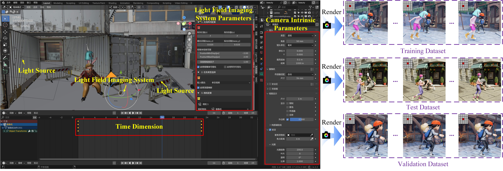
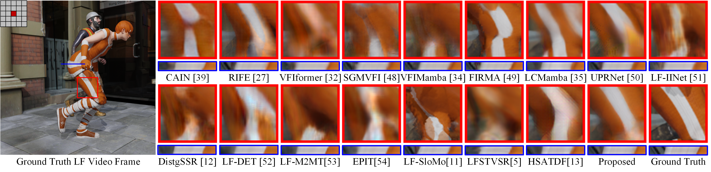
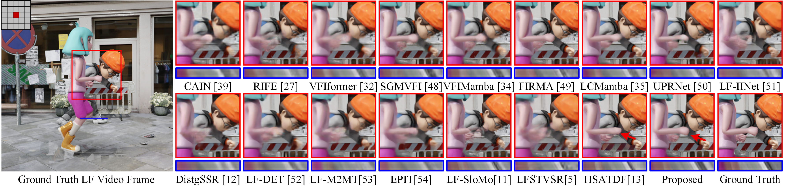
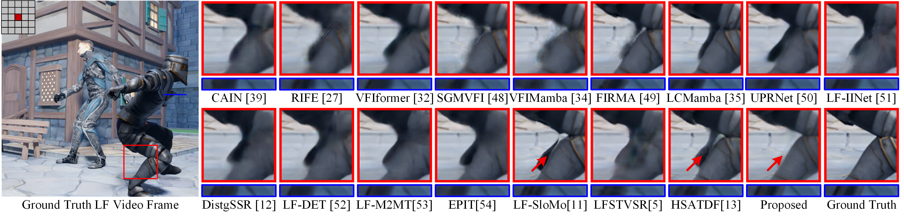

# FMS-Net

> ✅ **Note:** The **complete code**, **trained weights**, **NBU-LFV dataset**, **light field rendering plugin**, and **results from various methods** will be publicly released upon acceptance of our paper. Training and testing instructions will be provided at that time. See [TODO](#-todo) for planned releases and [Download](#-download) for availability.
>
> Thank you for your patience and interest!
>
> If you find this project helpful, please consider giving this repository a ⭐. Thanks!

Given two RGB light fields, FMS-Net synthesizes the intermediate light field by combining bidirectional motion estimation, dynamic spatial–angular feature modeling, and progressive frame synthesis.

## 📋 TODO

The following items will be made available upon acceptance of our paper:

- 💻 Release the training and testing code.
- 📚 Release the NBU-LFV dataset.
- 🎨 Open-source the light field rendering plugin.
- 🧠 Release pretrained weights.
- 🖼️ Release results from various methods.
- 📖 Add installation and usage instructions.

## 📚 NBU-LFV Dataset

*NBU-LFV dataset generation in Blender.*

The **NBU-LFV** dataset contains **35 scenes**. Each light field consists of **5 × 5 RGB views** at **512 × 512 pixels per view**.

Training, validation, and testing use separate scenes:

| Split | Scenes |
|---|---:|
| Training | 22 |
| Validation | 3 |
| Testing | 10 |
| **Total** | **35** |

## 🖼️ Qualitative Results

Visual comparisons of reconstructed frames. Red boxes show enlarged spatial details; blue strips show epipolar-plane images (EPIs).

*Scene 5.*

*Scene 15.*

*Comparison of reconstructed spatial details and EPIs.*

## 📥 Download

| Resource | Availability |
|---|---|
| Training and testing code | After paper acceptance |
| NBU-LFV dataset | After paper acceptance |
| Light field rendering plugin | After paper acceptance |
| Trained weights | After paper acceptance |
| Results from various methods | After paper acceptance |

## 📬 Contact

**✉️ Email:** [chenzean2024@126.com](mailto:chenzean2024@126.com)
